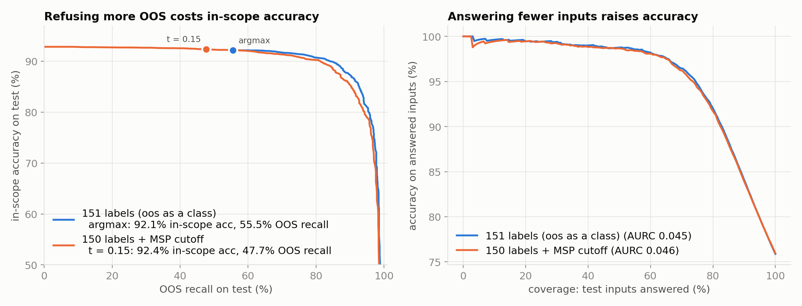
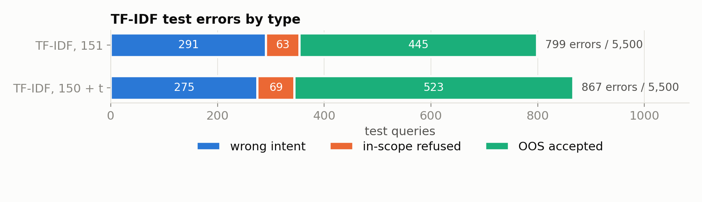

# TF-IDF + logistic regression baseline

Model 1 of the proposal: a bag-of-n-grams baseline for CLINC150 (OOS-plus) intent
classification with out-of-scope (OOS) detection. It is scored with the team protocol in
`common_eval.py` / `evaluate.py`, so its numbers sit in the same table as RoBERTa,
zero-shot and LoRA.

## Quick start

```bash
pip install -r requirements_tfidf.txt
python download_data.py                    # 1. data  -> data/data_oos_plus.json
python explore_dataset.py --json data/data_oos_plus.json --outdir results/explore   # 2. stats (optional)
python eda.py                              #    EDA figures -> results/eda/ (optional)
python tfidf_baseline.py --save-models     # 3. train, tune on val, evaluate on test (~1 min, CPU)
python tfidf_visualize.py                  # 4. figures -> results/tfidf/
python tfidf_predict.py --test-head 10     # 5. predictions with the saved models
```

No GPU is needed. Everything runs from the repo root; paths are resolved relative to the
scripts.

## Steps

**1. Data** (`download_data.py`). Downloads the canonical `data_oos_plus.json` from
[clinc/oos-eval](https://github.com/clinc/oos-eval) (CC BY 3.0) into `data/` and checks the
split sizes. We do not use the HuggingFace `clinc_oos` copy, which repeats every example three
times. `data/` is git-ignored.

| split | in-scope | OOS | total |
|---|---:|---:|---:|
| train | 15,000 | 250 | 15,250 |
| val | 3,000 | 100 | 3,100 |
| test | 4,500 | 1,000 | 5,500 |

**2. Exploration** (`explore_dataset.py`, `eda.py`, already in the repo). Split sizes,
per-intent balance, duplicates, utterance lengths (mean 8.3 words, max 28, so no truncation),
confusable intents, how close OOS queries are to supported intents.

**3. Preprocessing, training, evaluation** (`tfidf_baseline.py`).
- Preprocessing happens inside the vectorizers, so a saved model takes raw text: lowercase,
  whitespace normalisation, nothing removed or truncated.
- Features: word 1-2 gram TF-IDF + character (`char_wb`) 2-5 gram TF-IDF (min_df=2),
  sublinear tf; about 54k features.
- Classifier: multinomial `LogisticRegression`, C in {1, 3, 10, 30, 100}, picked on val
  without any OOS threshold (151: val 151-way accuracy; 150: val in-scope accuracy).
- Val/test probabilities are written to `runs/tfidf_{151,150}/{val,test}.npz` in the
  `evaluate.py` format, then scored with `common_eval.test_eval`.

**4. Figures** (`tfidf_visualize.py`), from `results/tfidf/{curves.json,tfidf_report.json}`.

**5. Prediction** (`tfidf_predict.py`). Loads `models/tfidf_{151,150}.joblib` and prints both
settings for any input sentences or the first N test queries. The saved models need the
scikit-learn version in `requirements_tfidf.txt`; retraining takes about a minute.

## Protocol (same as `common_eval.py`)

| setting | training data | refuse (predict oos) when | OOS score for AUROC |
|---|---|---|---|
| 151 labels | train + oos_train | argmax = oos | P(oos) |
| 150 labels | in-scope train only | max in-scope prob (MSP) < t, t in {0, 0.01, ..., 0.99} chosen on val by OOS F1 | 1 - MSP |

Metrics: `in_acc` (refusing an in-scope query counts as wrong), `in_macro_f1` (over the 150
intents, on all 5,500 test queries), OOS precision / recall / F1, AUROC, `overall_acc`
(151-way). TF-IDF is deterministic, so we report 95% bootstrap CIs over test queries, as for
zero-shot.

## Results (test, %)

| system | config | in_acc | oos_recall | oos_precision | oos_f1 | in_macro_f1 | auroc | overall_acc |
|---|---|---|---|---|---|---|---|---|
| TF-IDF 151 | C=10 | 92.1 [91.4, 92.9] | 55.5 [52.1, 58.4] | 89.8 [87.4, 92.1] | 68.6 [65.8, 71.0] | 88.6 [87.7, 89.3] | 95.3 [94.7, 96.0] | 85.5 [84.5, 86.4] |
| TF-IDF 150 | C=30, t=0.15 | 92.4 [91.6, 93.1] | 47.7 [44.5, 51.0] | 87.4 [84.5, 90.1] | 61.7 [58.8, 64.7] | 88.3 [87.3, 88.9] | 95.0 [94.3, 95.7] | 84.2 [83.3, 85.1] |





- In-scope accuracy is already about 92% with n-grams alone; the hard part is refusing OOS.
- At the protocol operating points both settings refuse only half of the OOS queries, and
  accepted OOS queries are the largest error type (445 and 523 of 1,000).
- The OOS score separates OOS from in-scope about equally well in both settings (AUROC 95.3
  vs 95.0). The 150-label cutoff picked by val OOS F1 is low (t = 0.15) because only 3% of
  val is OOS versus 18% of test; the left figure shows how much more OOS a higher cutoff
  would refuse and what it costs in in-scope accuracy.
- Frequent confusions are between near-synonymous intents (e.g. `calendar` -> `calendar_update`,
  `redeem_rewards` -> `rewards_balance`, `food_last` -> `expiration_date`); see
  `intent_confusions` in `results/tfidf/tfidf_report.json`.

## Files

| path | in git | contents |
|---|---|---|
| `download_data.py`, `tfidf_baseline.py`, `tfidf_visualize.py`, `tfidf_predict.py` | yes | code |
| `requirements_tfidf.txt` | yes | package versions used (Python 3.12) |
| `results/tfidf/tfidf_table.md`, `tfidf_report.json` | yes | test metrics with CIs, val C grid, error breakdown, top confusions |
| `results/tfidf/curves.json`, `fig_tfidf_*.png` | yes | threshold and coverage curves, figures |
| `results/tfidf/test_predictions.csv` | no | per-query predictions on test |
| `runs/tfidf_{151,150}/{val,test}.npz` | no | probabilities in the `evaluate.py` format |
| `models/tfidf_{151,150}.joblib` | no | trained pipelines (~50 MB each, `--save-models`) |
